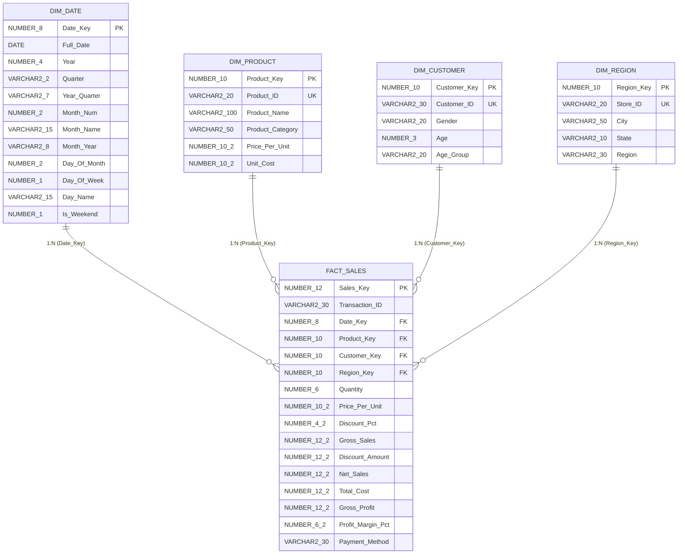

# Star Schema Architecture & Dimensional Model Specification
**Project 1: Sales Performance Dashboard**
**Framework**: Kimball Dimensional Modeling Methodology

---

## 1. Architectural Overview
The analytical data layer is designed as a **Kimball Star Schema** deployed across Oracle Database and Power BI. This architecture separates transactional quantitative measures (`FACT_SALES`) from descriptive qualitative context (`DIM_DATE`, `DIM_PRODUCT`, `DIM_CUSTOMER`, `DIM_REGION`).

### Core Advantages:
1. **Query Performance**: Eliminates costly snowflaked joins; enables Oracle cost-based optimizer to leverage Star Transformation queries and bitmap indexes.
2. **Intuitive Power BI Modeling**: Provides clean 1-to-many relationships, eliminating bidirectional ambiguity and memory bloat.
3. **Consistent Business Logic**: All business measures (AOV, Gross Profit, MoM Growth) are computed off conformed dimensions.

---

## 2. Entity-Relationship Star Schema Diagram

---

## 3. Data Dictionary

### Table: `FACT_SALES` (Fact Table)
- **Granularity**: One row per distinct sales order line.
- **Physical Row Count**: 4,927 records.

| Column Name | Data Type | Key Type | Nullable | Description | Sample Value |
|---|---|---|---|---|---|
| `SALES_KEY` | NUMBER(12) | PK | No | Unique surrogate key for each sales record | `1` |
| `TRANSACTION_ID` | VARCHAR2(30) | NK | No | Source transaction natural identifier | `TXN-000001` |
| `DATE_KEY` | NUMBER(8) | FK | No | Foreign key referencing `DIM_DATE(DATE_KEY)` | `20230514` |
| `PRODUCT_KEY` | NUMBER(10) | FK | No | Foreign key referencing `DIM_PRODUCT(PRODUCT_KEY)` | `14` |
| `CUSTOMER_KEY` | NUMBER(10) | FK | No | Foreign key referencing `DIM_CUSTOMER(CUSTOMER_KEY)` | `102` |
| `REGION_KEY` | NUMBER(10) | FK | No | Foreign key referencing `DIM_REGION(REGION_KEY)` | `4` |
| `QUANTITY` | NUMBER(6) | Measure | No | Physical number of product units sold | `2` |
| `PRICE_PER_UNIT` | NUMBER(10,2) | Attribute | No | Unit selling price in USD | `499.99` |
| `DISCOUNT_PCT` | NUMBER(4,2) | Attribute | No | Markdown percentage applied (0.00 to 0.90) | `0.10` |
| `GROSS_SALES` | NUMBER(12,2) | Measure | No | Total gross sales before discount (`Qty * Price`) | `999.98` |
| `DISCOUNT_AMOUNT` | NUMBER(12,2) | Measure | No | Dollar savings granted (`Gross * Discount_Pct`) | `99.99` |
| `NET_SALES` | NUMBER(12,2) | Measure | No | Net recognized revenue (`Gross - Discount`) | `899.99` |
| `TOTAL_COST` | NUMBER(12,2) | Measure | No | Cost of goods sold (`Qty * Unit_Cost`) | `649.98` |
| `GROSS_PROFIT` | NUMBER(12,2) | Measure | No | Net profit dollars (`Net_Sales - Total_Cost`) | `250.01` |
| `PROFIT_MARGIN_PCT` | NUMBER(6,2) | Measure | No | Margin percentage (`Profit / Net_Sales * 100`) | `27.78` |
| `PAYMENT_METHOD` | VARCHAR2(30) | Attribute | No | Method of customer payment | `Credit Card` |

---

### Table: `DIM_DATE` (Conformed Dimension)
- **Granularity**: One row per calendar date.
- **Physical Row Count**: 731 records (2023-01-01 through 2024-12-31).

| Column Name | Data Type | Key Type | Nullable | Description | Sample Value |
|---|---|---|---|---|---|
| `DATE_KEY` | NUMBER(8) | PK | No | Smart surrogate key integer `YYYYMMDD` | `20230101` |
| `FULL_DATE` | DATE | Attribute | No | Native date timestamp | `2023-01-01` |
| `YEAR` | NUMBER(4) | Attribute | No | 4-digit calendar year | `2023` |
| `QUARTER` | VARCHAR2(2) | Attribute | No | Calendar quarter code | `Q1` |
| `YEAR_QUARTER` | VARCHAR2(7) | Attribute | No | Composite period string | `2023-Q1` |
| `MONTH_NUM` | NUMBER(2) | Attribute | No | Numeric month (1 to 12) | `1` |
| `MONTH_NAME` | VARCHAR2(15) | Attribute | No | Full English month name | `January` |
| `MONTH_YEAR` | VARCHAR2(8) | Attribute | No | Abbreviated month and year | `Jan 2023` |
| `DAY_OF_MONTH` | NUMBER(2) | Attribute | No | Calendar day (1 to 31) | `1` |
| `DAY_OF_WEEK` | NUMBER(1) | Attribute | No | Numeric weekday (1 = Mon, 7 = Sun) | `7` |
| `DAY_NAME` | VARCHAR2(15) | Attribute | No | Full day name | `Sunday` |
| `IS_WEEKEND` | NUMBER(1) | Attribute | No | Binary flag (1 = Weekend, 0 = Weekday) | `1` |

---

### Table: `DIM_PRODUCT` (Catalog Dimension)
- **Granularity**: One row per unique retail SKU.
- **Physical Row Count**: 34 products across 5 categories.

| Column Name | Data Type | Key Type | Nullable | Description | Sample Value |
|---|---|---|---|---|---|
| `PRODUCT_KEY` | NUMBER(10) | PK | No | Surrogate product identifier | `1` |
| `PRODUCT_ID` | VARCHAR2(20) | NK | No | Natural SKU identifier code | `PROD-E101` |
| `PRODUCT_NAME` | VARCHAR2(100) | Attribute | No | Full commercial product name | `Smartphone 5G Pro` |
| `PRODUCT_CATEGORY` | VARCHAR2(50) | Attribute | No | Merchandise division | `Electronics` |
| `PRICE_PER_UNIT` | NUMBER(10,2) | Attribute | No | Standard list price | `799.99` |
| `UNIT_COST` | NUMBER(10,2) | Attribute | No | Inventory cost per unit | `519.99` |

---

### Table: `DIM_CUSTOMER` (Demographics Dimension)
- **Granularity**: One row per individual registered customer.
- **Physical Row Count**: 1,189 unique customer profiles.

| Column Name | Data Type | Key Type | Nullable | Description | Sample Value |
|---|---|---|---|---|---|
| `CUSTOMER_KEY` | NUMBER(10) | PK | No | Surrogate customer key | `1` |
| `CUSTOMER_ID` | VARCHAR2(30) | NK | No | Natural account identifier | `CUST-0001` |
| `GENDER` | VARCHAR2(20) | Attribute | No | Customer gender profile | `Female` |
| `AGE` | NUMBER(3) | Attribute | Yes | Customer age in years | `34` |
| `AGE_GROUP` | VARCHAR2(20) | Attribute | No | Demographic cohort (`18-24`, `25-34`, etc.) | `25-34` |

---

### Table: `DIM_REGION` (Territory Dimension)
- **Granularity**: One row per retail store branch.
- **Physical Row Count**: 10 physical locations.

| Column Name | Data Type | Key Type | Nullable | Description | Sample Value |
|---|---|---|---|---|---|
| `REGION_KEY` | NUMBER(10) | PK | No | Surrogate store location key | `1` |
| `STORE_ID` | VARCHAR2(20) | NK | No | Natural store code | `STR-101` |
| `CITY` | VARCHAR2(50) | Attribute | No | City of operation | `New York` |
| `STATE` | VARCHAR2(10) | Attribute | No | State or province abbreviation | `NY` |
| `REGION` | VARCHAR2(30) | Attribute | No | Commercial sales territory (East, West, etc.) | `East` |
