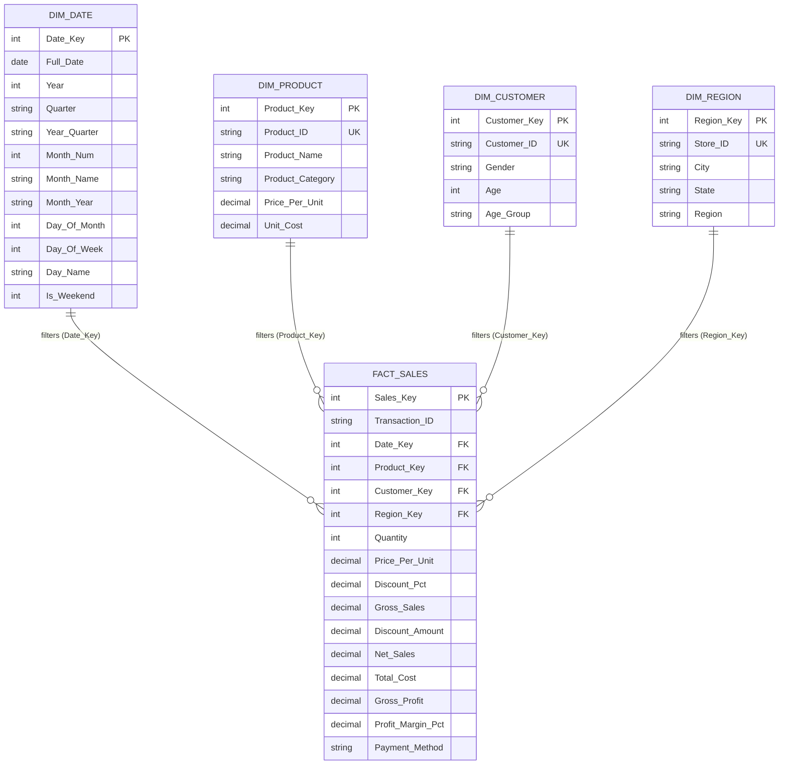

# Dimensional Data Model Documentation
**Kimball Star Schema Architecture for Sales Performance Dashboard**

## 1. Schema Paradigm
This data model strictly adheres to Ralph Kimball's dimensional modeling standard for enterprise data warehouses and business intelligence systems. It decouples high-volume additive transactional events (Facts) from descriptive contextual hierarchies (Dimensions).

## 2. Granularity
The atomic grain of `FACT_SALES` is **one individual line-item transaction** placed by a customer for a distinct product at a specific retail store location on a specific date.

## 3. Dimension Specifications

### `DIM_DATE` (Conformed Date Dimension)
- **Role**: Conformed role-playing time intelligence dimension.
- **Grain**: One record per calendar day spanning 2023-01-01 through 2024-12-31 (731 days).
- **Surrogate Key**: `Date_Key` integer formatted as `YYYYMMDD` (e.g., `20230514`).
- **Attributes**: Supports fiscal and calendar quarters, month numbers for sorting, and weekend flags.

### `DIM_PRODUCT` (Catalog Dimension)
- **Role**: Descriptive categorization of merchandise inventory.
- **Grain**: One record per unique SKU / Product ID (34 distinct product SKUs).
- **Attributes**: Product Name, Category, Baseline Catalog Unit Price, Unit COGS.

### `DIM_CUSTOMER` (Demographics Dimension)
- **Role**: Customer segmentation and purchasing behavior analysis.
- **Grain**: One record per unique Customer ID (1,189 unique customers).
- **Attributes**: Gender, Age, Age Group Cohort (`18-24`, `25-34`, `35-49`, `50-64`, `65+`).

### `DIM_REGION` (Territory Dimension)
- **Role**: Geographic hierarchy for physical store networks.
- **Grain**: One record per retail store branch (10 retail locations).
- **Hierarchy**: `Region` -> `State` -> `City` -> `Store_ID`.

---

## 4. Cardinality & Cross-Filtering Strategy
- All dimension-to-fact relationships are **1-to-Many (`1:*`)**.
- Cross-filter direction is strictly **Single Direction** (`Dimension -> Fact`).
- Bi-directional cross-filtering is avoided to eliminate query ambiguity, circular paths, and performance degradation in high-volume enterprise reporting.
